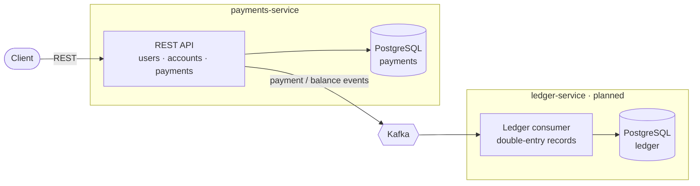

# PaymentsAPI

A payments system built with **Java 21**, **Spring Boot 3.5** and **Clean Architecture**, designed to grow into two
microservices that communicate through Kafka:

- **payments-service**: users, accounts, balances and payments (this repository's current code).
- **ledger-service** *(planned)*: an append-only, double-entry ledger that records every money movement published
  by the payments-service.

## Architecture



Each service follows the same layering:

| Layer | Contents | Spring allowed? |
|---|---|---|
| `domain` | Entities (`User`, `Account`, `Payment`), domain exceptions, ports (`AccountRepository`, `PasswordEncoder`) | No |
| `application` | Use cases, application ports (`TransactionRunner`) | No |
| `infrastructure` | JPA adapters, BCrypt adapter, transactional runner, `@Configuration` classes that register use cases as `@Bean`s | Yes |
| `interfaces` | REST controllers and DTOs | Yes |

## What is ready

- Users: create, read (by id / email), update profile, change password, delete. Passwords are hashed with BCrypt
  and never returned by the API.
- Accounts: one account per user, lookup by id or user id, delete.
- `POST /api/v1/accounts/{id}/deposit` and `POST /api/v1/accounts/{id}/withdraw` with validated amounts.
- Concurrency-safe balances: deposits and withdrawals run in a transaction that locks the account row
  (`SELECT ... FOR UPDATE`), with `@Version` optimistic locking as a second guard and a bounded retry
  (3 attempts, then `409 Conflict`).
- UUID identifiers; Flyway migrations with foreign keys, `NUMERIC(19,2)` money and a non-negative balance check.
- Consistent error responses: `400` invalid input, `404` not found, `409` conflict, `422` insufficient balance.
- `Payment` domain model with its state machine (`PENDING → AUTHORIZED → COMPLETED → REVERSED`, `FAILED`).
- Unit, use case (Mockito), WebMvc and Testcontainers integration tests, including 100 concurrent withdrawals
  against a real PostgreSQL.
- Dockerfile (multi-stage) and `docker-compose.yml`.

### API overview

| Method | Path | Description |
|---|---|---|
| `POST` | `/api/v1/users` | Create user |
| `GET` | `/api/v1/users/{id}` | Find user by id |
| `GET` | `/api/v1/users/email?email=` | Find user by email |
| `PUT` | `/api/v1/users/{id}` | Update profile |
| `PUT` | `/api/v1/users/{id}/password` | Change password |
| `DELETE` | `/api/v1/users/{id}` | Delete user |
| `POST` | `/api/v1/accounts` | Create account for a user |
| `GET` | `/api/v1/accounts/{id}` | Find account by id |
| `GET` | `/api/v1/accounts/user/{userId}` | Find account by user id |
| `POST` | `/api/v1/accounts/{id}/deposit` | Deposit `{ "amount": 100.00 }` |
| `POST` | `/api/v1/accounts/{id}/withdraw` | Withdraw `{ "amount": 10.00 }` |
| `DELETE` | `/api/v1/accounts/{id}` | Delete account |

## Roadmap

1. **Payments API**: persist `Payment`, expose endpoints to create and drive payments through the state machine,
   with idempotency keys enforced by a unique constraint.
2. **Transfers**: move money between two accounts atomically (consistent lock ordering to avoid deadlocks).
3. **Event publishing**: transactional outbox in the payments-service and a Kafka relay.
4. **ledger-service**: new service consuming payment events into a double-entry ledger, with idempotent consumers.
5. **Reconciliation**: compare account balances with ledger totals.
6. **Operational readiness**: authentication, Actuator health checks, metrics, tracing and OpenAPI docs.

## Running with Docker

Requirements: Docker with Compose v2.

```bash
cp .env.example .env   # optional: defaults work out of the box
docker compose up --build
```

The API is served at `http://localhost:8080` and PostgreSQL is exposed on `localhost:5433`.
Stop with `docker compose down` (add `-v` to also drop the database volume).

### Running the service locally

Start only the database, then run the service with the Maven wrapper:

```bash
docker compose up -d postgres
cd payments-service
./mvnw spring-boot:run
```

Database settings come from `DB_URL`, `DB_USERNAME` and `DB_PASSWORD` (see `.env.example`); the defaults point
to the compose database.

## Running the tests

Requirements: JDK 21 and a running Docker daemon (integration tests use Testcontainers).

```bash
cd payments-service
./mvnw verify
```

To run only the concurrency test:

```bash
./mvnw test -Dtest=WithdrawConcurrencyIntegrationTest
```

## Repository layout

```
.
├── docker-compose.yml
├── .env.example
├── README.md
└── payments-service/
    ├── Dockerfile
    ├── pom.xml
    └── src/
```
